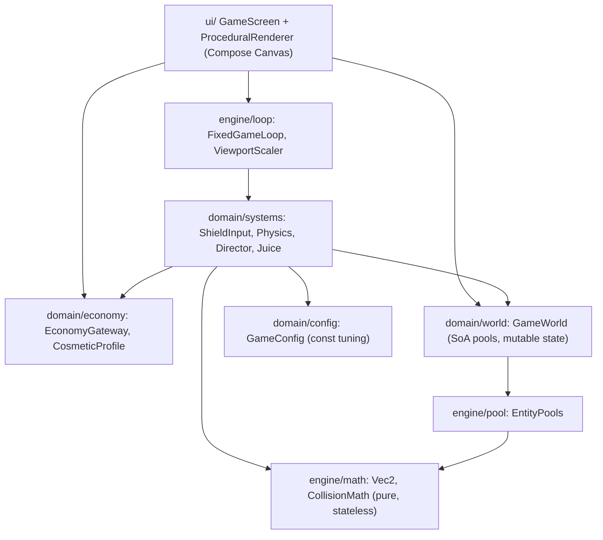
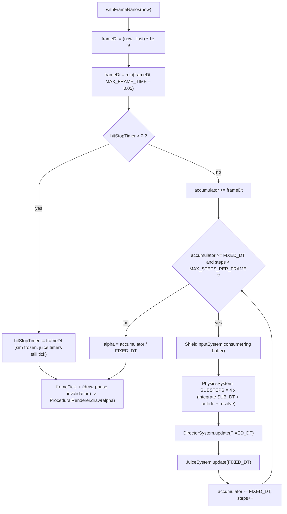
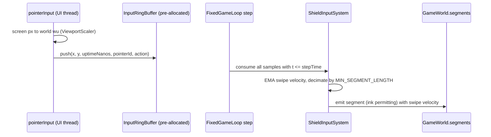

# ARCHITECTURE — Bubble Defense

Owner: **[ARCH-AGENT]** · Status: Phase 1 spec (pools/loop implemented in Phase 2)

---

## 1. Layered Module Map

Dependency rule: arrows point *downwards only*. `engine/math` depends on nothing but
`kotlin.math`. `engine/*` never imports `domain/*` or `ui/*`. Only `ui/` imports Compose.
Third-party Ad/Billing SDKs are strictly quarantined behind `domain/economy/EconomyGateway.kt`
and never imported by engine or simulation systems.

---

## 2. Coordinate Spaces

| Space | Origin | Axes | Extent | Used by |
|---|---|---|---|---|
| **World (wu)** | top-left | +X right, **+Y down** | `1000 x 1800` | all simulation, all docs |
| **Screen (px)** | top-left of Canvas | +X right, +Y down | device-dependent | Compose draw + pointer events |
| **Normalized** | top-left | +X right, +Y down | `[0,1] x [0,1]` | design specs only (e.g. bubble at `(0.5, 0.82)`) |

### 2.1 ViewportScaler (World ↔ Screen), uniform letterbox fit

Given canvas size `(Sw, Sh)` px:

$$s = \min\left(\frac{S_w}{1000}, \frac{S_h}{1800}\right), \quad
o_x = \frac{S_w - 1000\,s}{2}, \quad o_y = \frac{S_h - 1800\,s}{2}$$

$$\text{screen} = \text{world}\cdot s + (o_x, o_y), \qquad
\text{world} = \frac{\text{screen} - (o_x, o_y)}{s}$$

- Aspect ratio is preserved; the letterbox bars are filled with the background palette
  (parallax layers extend beyond the world rect, so bars are visually seamless).
- Pointer input is converted **screen → world immediately** in the input handler, so every
  input threshold (e.g. `MIN_SEGMENT_LENGTH = 12 wu`) is resolution-independent.
  At a 1080-px-wide device `s ≈ 1.08`, so 1 wu ≈ 1 px.
- Screen-shake offsets are applied in **screen px** after the world transform (camera-only
  effect, never affects simulation).

### 2.2 Key world positions

| Item | Normalized | World (wu) |
|---|---|---|
| Bubble center | `(0.5, 0.82)` | `(500, 1476)` |
| Spawn line | `y = -0.033` | `y = -60` |
| Despawn bounds | — | `x ∈ [-150, 1150]`, `y ∈ [-400, 1950]` |

---

## 3. Fixed-Timestep Game Loop

| Constant | Value | Notes |
|---|---|---|
| `FIXED_DT` | `1/120 s` | one simulation step |
| `SUBSTEPS` | `4` | collision sub-steps per fixed step |
| `SUB_DT` | `1/480 s` | `FIXED_DT / SUBSTEPS` |
| `MAX_FRAME_TIME` | `0.05 s` | spiral-of-death clamp |
| `MAX_STEPS_PER_FRAME` | `6` | `= MAX_FRAME_TIME / FIXED_DT`; leftover accumulator is kept |
| `HIT_STOP_DURATION` | `0.020 s` | freeze-frame on parry (real time, not sim time) |

**Rules**
- `withFrameNanos` callback is a **single pre-allocated function reference** stored in the loop
  (`private val frameCallback: (Long) -> Unit = ::onFrame`), so no lambda is allocated per frame.
- Known framework allocation: `withFrameNanos` internally allocates a continuation/awaiter per
  frame (Compose runtime). This is young-gen, ~2 small objects/frame, and is the only accepted
  allocation; it is outside our control and is documented here intentionally.
- Rendering reads `frameTick` (a `mutableLongStateOf`) **inside the draw lambda only**, so a
  frame triggers a draw-phase invalidation without recomposition.
- Interpolated render position: `p = prev + (curr - prev) * alpha`. Systems copy `curr → prev`
  at the start of each fixed step.
- Hit-stop freezes the accumulator (sim time stops) but the render loop, screen-shake decay,
  and particle *rendering* continue, so the freeze reads as impact, not as a hang.

---

## 4. Memory Pools (Structure-of-Arrays)

All pools are allocated once in `GameWorld`'s constructor and never resized.
Each pool exposes `count: Int` (active entities are dense in `[0, count)`).

### 4.1 Pool capacities and overflow policy

| Pool | Capacity | Removal | Overflow policy |
|---|---|---|---|
| `ObstaclePool` | **128** | swap-remove | spawn request rejected (Director retries next step) |
| `ShieldSegmentPool` | **256** | swap-remove | oldest segment (max `age`) is shattered and replaced |
| `ParticlePool` | **512** | swap-remove | overwrite slot at rolling cursor (`cursor = (cursor+1) and 511`) |
| `FloatingTextPool` | **32** | swap-remove | overwrite slot at rolling cursor (`and 31`) |
| `InputRingBuffer` | **256** samples | ring | oldest sample dropped, `droppedSamples++` (debug counter) |

Capacities are powers of two so rolling cursors use `and (cap - 1)` instead of `%`.

### 4.2 Field layouts

**ObstaclePool (128)** — 18 fields

| Field | Type | Meaning |
|---|---|---|
| `x, y` | `FloatArray` | current center (wu) |
| `prevX, prevY` | `FloatArray` | center at previous fixed step (render interpolation) |
| `vx, vy` | `FloatArray` | velocity (wu/s) |
| `radius` | `FloatArray` | collision radius (wu) |
| `invMass` | `FloatArray` | `1/mass` (impulse magnitude & juice) |
| `restitution` | `FloatArray` | `e` per archetype |
| `angle, angVel` | `FloatArray` | visual rotation only (rad, rad/s) |
| `age` | `FloatArray` | seconds since spawn |
| `hitCooldown` | `FloatArray` | per-obstacle shield re-hit damage cooldown (s) |
| `type` | `ByteArray` | 0 Drifter, 1 Needle, 2 Crusher, 3 Splitter, 4 Shard |
| `flags` | `IntArray` | bit0 `HAS_SPLIT`, bit1 `CCD`, bit2 `DEFLECTED`, bit3 `PARRIED` |
| `lastSegment` | `IntArray` | slot index of last shield hit (−1 none) |
| `id` | `IntArray` | monotonically increasing spawn id (stable identity for juice) |
| `seed` | `IntArray` | per-entity RNG seed for procedural shape jitter |

**ShieldSegmentPool (256)** — 16 fields

| Field | Type | Meaning |
|---|---|---|
| `ax, ay, bx, by` | `FloatArray` | endpoints (wu) |
| `nx, ny` | `FloatArray` | unit geometric normal `perp(B−A)/‖B−A‖` (cached) |
| `swipeVx, swipeVy` | `FloatArray` | filtered pointer velocity at creation (wu/s, clamped to `MAX_SWIPE_SPEED`) |
| `age` | `FloatArray` | seconds since creation (drives parry decay & fade) |
| `integrity` | `FloatArray` | structural integrity, starts at `100` |
| `recoil` | `FloatArray` | accumulated Crusher recoil offset (wu, visual + positional) |
| `length` | `FloatArray` | cached `‖B−A‖` |
| `strokeId` | `IntArray` | stroke that produced it (render joins, multi-touch) |
| `pointerId` | `IntArray` | pointer index `0..3` |
| `flashTimer` | `FloatArray` | impact flash (s) |
| `id` | `IntArray` | stable id |

**ParticlePool (512)** — 11 fields: `x, y, prevX, prevY, vx, vy, life, maxLife, size, rotation (FloatArray)`, `color (IntArray ARGB)`.
Line-shard particles store their half-length in `size` and orientation in `rotation`.

**FloatingTextPool (32)** — 7 fields: `x, y, vy, life, maxLife, scale (FloatArray)`, `textId (ByteArray)`
indexing a fixed table of pre-measured strings (`PARRY!`, `+5`, `+10`, `+50`, `+100`, `SPLIT!`, `CRUSH!`, `x2`…`x4`).

### 4.3 Memory budget

| Pool | Floats/ints per slot | Slots | Bytes |
|---|---|---|---|
| Obstacles | ~18 × 4 B | 128 | ~9.2 KB |
| Segments | ~16 × 4 B | 256 | ~16.4 KB |
| Particles | 11 × 4 B | 512 | ~22.5 KB |
| Floating text | ~7 × 4 B | 32 | ~0.9 KB |
| Input ring | `x,y,t,pointer,action` ≈ 20 B | 256 | ~5.1 KB |
| **Total** | | | **≈ 54 KB**, allocated once |

---

## 5. Broadphase (Phase 3)

Uniform grid over the world rect: `GRID_CELL = 100 wu` → `10 x 18 = 180` cells.
- Rebuilt once per **fixed step** (segments are static between steps except Crusher recoil,
  which marks the grid dirty).
- Storage: `cellStart: IntArray(181)`, `cellItems: IntArray(256 * 4)` (counting-sort build,
  each segment inserted into every cell its inflated AABB touches, max 4 cells for a
  segment ≤ 100 wu; longer segments are impossible because `MAX_SEGMENT_LENGTH = 48 wu`).
- Obstacle queries visit the cells overlapped by `AABB(center, r + SHIELD_RADIUS + |v|·SUB_DT)`.
- Duplicate pair suppression via a per-query `IntArray` stamp (`visitStamp[segment] == queryId`).

Cost bound: 128 obstacles × ~6 candidate segments × 4 sub-steps × 120 Hz ≈ 370k narrow-phase
tests/s — well within budget on mid-range devices.

---

## 6. Input Pipeline

- Up to `MAX_POINTERS = 4` simultaneous strokes; each pointer keeps its own last-committed
  point, filtered velocity, and stroke id in small fixed arrays.
- Pointer handlers use `awaitPointerEventScope` and iterate `event.changes` by index
  (`for (i in 0 until changes.size)`) — no iterator allocation.
- In accordance with `kotlin-ux-architect`: `PointerInputChange.historical` is iterated sequentially
  before `change.position` to guarantee smooth, non-jagged polyline decimation at 120Hz–240Hz touch polling.

---

## 7. Rendering Contract & Compose Phase Hygiene (Phase 3)

- **Compose Phase Discipline (`kotlin-ux-architect`):**
  - State reads for rapid animation/simulation variables are completely excluded from the Composition phase.
  - Draw-phase invalidation via `frameTick` reads inside `drawBehind` / `Canvas` lambda; zero recomposition during gameplay loop.
  - UI models annotated with `@Immutable` / `@Stable`.
  - All HUD numerical readouts use `fontFeatureSettings = "tnum"`.
- `ProceduralRenderer` holds every `Path`, `Paint`, `Stroke` and gradient shader as fields,
  created once per canvas size change.
- Neon glow: **multi-pass stroke** (3 passes: width ×3.0 @ α 0.12, width ×1.8 @ α 0.28,
  width ×1.0 @ α 1.0, plus a 0.4× white core). `BlurMaskFilter` is used only on API ≥ 28
  where it is hardware-accelerated, and only for the bubble halo (one call per frame).
- Text (HUD score, floating text) is drawn via `nativeCanvas.drawText(CharArray, …)` with
  pre-allocated `android.graphics.Paint`; digits are written into a reusable `CharArray`.
- Bubble wobble uses a precomputed `cos/sin` table of `BUBBLE_VERTICES = 64` entries.

---

## 8. Math Core (Phase 1 — implemented)

- `Vec2` — `@JvmInline value class Vec2(val packed: Long)`; `x` in the high 32 bits,
  `y` in the low 32 bits, both stored via `Float.toRawBits()`. Compiles to a primitive `long`;
  boxing occurs only if used as nullable/generic/`Any` (banned in hot path).
- `CollisionMath` — stateless `object`; multi-value results are written into a caller-owned
  `Contact` instance (one per system, allocated at init).
- Full equations: `docs/PHYSICS_SPEC.md`.
