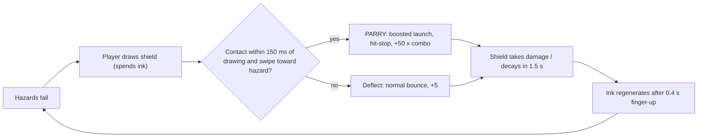

# GAME DESIGN — Bubble Defense

Owner: **[JUICE-AGENT]** (feel, palette) with **[PHYS-AGENT]** (economy numbers).
All distances in world units (wu, world = `1000 x 1800`, +Y down), times in seconds.

---

## 1. Core Fantasy & Loop

A fragile soap bubble drifts upward through a neon sky. Hazards rain down. The player
**draws glowing ink shields** with their fingers to deflect them — and, with perfect timing,
**slashes** a fresh shield into a hazard to **PARRY** it with a violent impulse.



Lose condition: the bubble's membrane HP reaches 0. Score = altitude climbed + bonuses.

---

## 2. The Bubble

| Property | Value |
|---|---|
| Position | normalized `(0.5, 0.82)` → world `(500, 1476)` (fixed on screen; the world scrolls) |
| `BUBBLE_RADIUS` | 64 wu |
| `BUBBLE_MAX_HP` | 3 |
| `BUBBLE_INVULN_TIME` | 1.0 s after a hit (membrane flickers at 12 Hz) |
| `WARNING_RING_RANGE` | 220 wu (distance from bubble surface) |

### 2.1 Soft-body wobble (procedural, render-only)

Radius at polar angle θ and time t, sampled at `BUBBLE_VERTICES = 64` vertices:

$$r(\theta, t) = R_0\left(1 + \sum_{k\in\{3,5,7\}} a_k(t)\,\sin(k\theta + \omega_k t + \varphi_k)\right)$$

| k | base $a_k$ | $\omega_k$ (rad/s) | $\varphi_k$ |
|---|---|---|---|
| 3 | 0.020 | 2.1 | 0.0 |
| 5 | 0.012 | 3.4 | 1.3 |
| 7 | 0.006 | 5.2 | 2.7 |

Impact excitation: on a bubble hit or a near-miss within 40 wu, every $a_k$ gets
`+0.05 × (base_k / 0.02)`, then decays back to base with $a_k \leftarrow base_k + (a_k - base_k)e^{-4\,dt}$.
Wobble amplitude is capped at `0.12` total so the silhouette never self-intersects.

### 2.2 Shield-warning proximity ring

Ring radius $R_0 + 18$ wu, stroke 4 wu. Intensity from the closest obstacle surface distance $d_{min}$:

$$I = \operatorname{clamp}\left(1 - \frac{d_{min}}{220}, 0, 1\right)^2$$

Alpha $= 0.15 + 0.85 I$, color lerps `Bubble Rim → Danger Red`; pulse frequency $2 + 6I$ Hz.

---

## 3. Ink Economy

| Constant | Value | Meaning |
|---|---|---|
| `INK_MAX` | 100 | full tank |
| `INK_PER_WU` | 0.08 | ink per wu of shield ⇒ full tank = **1250 wu** of line |
| `INK_REGEN_DELAY` | 0.4 s | starts after **all** pointers are lifted |
| `INK_REGEN_RATE` | 55 ink/s | 0 → 100 in 1.82 s (+0.4 s delay) |
| `INK_MIN_TO_START` | 4 | ink needed to begin a new stroke (≈ 50 wu) |

Formulas:

$$\text{cost} = \Vert\vec B - \vec A\Vert \cdot \text{INK\_PER\_WU}$$

$$\text{ink}(t + dt) = \begin{cases}
\text{ink} & \text{while any pointer is down, or } t_{up} < 0.4\\
\min(\text{INK\_MAX},\ \text{ink} + 55\,dt) & \text{otherwise}
\end{cases}$$

- If `ink < cost`, the segment is **truncated** to the affordable length `ink / INK_PER_WU`
  (if ≥ `MIN_SEGMENT_LENGTH`), ink hits 0, and the stroke ends (the finger must lift and
  the regen delay must elapse). The HUD ink bar flashes `Ink Low` red.
- Ink is spent at segment **commit** time, never for the uncommitted preview tip.

### 3.1 Stroke sampling & decimation

| Constant | Value |
|---|---|
| `MIN_SEGMENT_LENGTH` | 12 wu (≈ 12 px at reference scale) |
| `MAX_SEGMENT_LENGTH` | 48 wu (fast flicks are subdivided into equal pieces ≤ 48 wu) |
| `MAX_POINTERS` | 4 |
| `SWIPE_VELOCITY_TAU` | 0.020 s |

Per pointer sample $(\vec p, t)$ relative to the last committed point $\vec q$:
1. Instant velocity $\vec v_i = (\vec p - \vec p_{prev}) / (t - t_{prev})$ (skipped if $\Delta t \le 0$).
2. Filtered velocity $\vec v \leftarrow \vec v + (\vec v_i - \vec v)(1 - e^{-\Delta t/\tau})$, clamped to 3000 wu/s.
3. If $\Vert\vec p - \vec q\Vert < 12$: no segment (decimated).
4. Otherwise emit $\lceil \Vert\vec p - \vec q\Vert / 48 \rceil$ segments from $\vec q$ to $\vec p$, each storing $\vec v$; set $\vec q \leftarrow \vec p$.

---

## 4. Shield Segments

| Constant | Value |
|---|---|
| `SEGMENT_LIFETIME` | 1.5 s |
| `SEGMENT_INTEGRITY` | 100 |
| `SEGMENT_FADE_TIME` | last 0.3 s: alpha $= \text{remaining}/0.3$ |
| `SHIELD_RADIUS` | 6 wu (drawn core width 12 wu) |
| `PARRY_WINDOW` | 0.150 s (segment glows white-hot while `age < 0.15`) |
| Damage | see `PHYSICS_SPEC.md` §7 |

Shatter (integrity ≤ 0 or overflow eviction): spawn `clamp(round(length / 100 × 6), 3, 12)`
line-shard particles along the segment, velocity = segment normal × U(80, 260) wu/s ± the
impacting obstacle's velocity × 0.2, life U(0.25, 0.5) s. Natural expiry (age ≥ 1.5 s) fades
out without shattering.

Color by integrity $q = \text{integrity}/100$: `Shield Ink` at $q = 1$ → `Shield Strained` at $q \le 0.4$.

---

## 5. Obstacles

| Archetype | Shape (render) | Radius | Mass | e | Spawn speed (wu/s) | Threat cost | Unlock time | Weight |
|---|---|---|---|---|---|---|---|---|
| **Drifter** | circle w/ inner ring | 28 | 1.0 | 0.75 | 260–380 | 1.0 | 0 s | 50 |
| **Needle** | elongated triangle, aligned to velocity | 7 | 0.35 | 0.60 | 900–1400 | 1.5 | 20 s | 25 |
| **Splitter** | diamond with crack line | 32 | 1.2 | 0.70 | 300–420 | 2.5 | 45 s | 15 |
| **Crusher** | heavy hexagon, double outline | 46 | 4.0 | 0.30 | 180–260 | 4.0 | 75 s | 10 |
| Shard | small diamond | 14 | 0.4 | 0.80 | parent × 1.4 | — | — | — |

Gravity `520 wu/s²` acts on all obstacles. Deflected obstacles that leave the despawn bounds
(`x ∈ [-150, 1150]`, `y ∈ [-400, 1950]`) are removed; leaving via top or sides after a shield
contact awards **+10 "CLEARED"**.

---

## 6. Wave Director

Deterministic: all randomness from a seeded **xorshift32** RNG (`seed = runSeed`, never 0):

```
x ^= x << 13; x ^= x >>> 17; x ^= x << 5      // Int, 32-bit
uniform01 = (x >>> 8) * (1f / 16777216f)       // 24-bit mantissa-exact float in [0,1)
```

### 6.1 Threat budget

$$\dot B(t) = \lambda(t)\cdot\phi(t), \qquad \lambda(t) = 1.0 + 0.045\,t \;\;[\text{threat/s}], \quad \lambda \le 6.0$$

Wave rhythm with period `WAVE_PERIOD = 20 s`: pressure for 14 s ($\phi = 1$), breather for 6 s ($\phi = 0.25$).

### 6.2 Spawn rule (per fixed step)

1. `B += λ φ · FIXED_DT`.
2. If `spawnCooldown ≤ 0` and no pending pick: pick an archetype by weight among unlocked ones.
3. If `B ≥ cost(pick)` and `ObstaclePool.count < 128`: spawn, `B -= cost`, `spawnCooldown = 0.25 s`.
4. `B` is capped at 8 (no huge bursts after a breather).

### 6.3 Spawn kinematics

- Position: `x = U(80, 920)`, `y = -60`.
- Aim point: bubble center + `(U(-180, 180), 0)`; direction rotated by `U(-12°, +12°)`.
- Speed: `U(min, max)` from the table × difficulty speed factor `1 + 0.004 t` (cap ×1.6).

---

## 7. Altitude, Score & Multipliers

| Constant | Value |
|---|---|
| `ASCENT_SPEED_BASE` | 8 m/s |
| `ASCENT_ACCEL` | 0.06 m/s² |
| `ASCENT_SPEED_MAX` | 30 m/s |
| `WU_PER_METER` | 40 wu |

$$v_{asc}(t) = \min(8 + 0.06\,t,\ 30)\ \text{m/s}, \qquad \text{altitude} = \int v_{asc}\,dt$$

$$\text{score} = \lfloor\text{altitude}\rfloor + \text{bonus}$$

| Event | Bonus points |
|---|---|
| Deflect (passive bounce) | +5 |
| Cleared (deflected hazard exits top/sides) | +10 |
| Splitter split | +10 |
| **PARRY** | **+50 × multiplier** |
| Parry on Crusher | +100 × multiplier |

Combo multiplier: $M = \min(1 + 0.25\,c,\ 4.0)$ where $c$ = consecutive parries.
$c$ resets to 0 on a bubble hit or after `COMBO_TIMEOUT = 3.0 s` without a parry.

Parallax layers scroll by `altitude × WU_PER_METER × factor`:

| Layer | Factor | Content |
|---|---|---|
| Far | 0.15 | star field (precomputed 96 points) |
| Mid | 0.40 | neon grid horizon lines every 240 wu |
| Near | 0.80 | drifting cloud wisps (12 procedural blobs) |

---

## 8. Juice & Kinetic Flow Specification (`kinetic-flow-architect`)

### 8.1 The 3-Tier Dopamine Clock
1. **Micro-Clock (0.3s–1.5s):** Instant physical/auditory feedback on every stroke, deflection, and near-miss.
2. **Meso-Clock (8s–20s):** Active parry windows, clutch ink refund (+25%), and sawtooth director pacing (14s crunch vs 6s harvest).
3. **Macro-Clock (45s–120s):** Near-miss milestone callout on Game Over, sub-300ms instant retry state (`TAP ANYWHERE TO RETRY` active within 350ms).

### 8.2 Sensory Amplification Matrix

| Event | Hit-Stop (Time Dilation) | Trauma Added ($\Delta T$) | Directional Particles | Audio / Pitch Modulation | Haptic Feedback |
|---|---|---|---|---|---|
| **Standard Bounce** | `0ms` | `+0.08` | 6–10 sparks along normal | Base pitch ±0.05 | Micro-tick (5ms) |
| **Perfect Parry (<150ms)** | `28ms` freeze frame | `+0.28` | 24 shards along $\vec{V}_{new}$ | Semitone up: `1.0 + combo * 0.05` | Crisp double-tap |
| **Crusher Impact** | `20ms` | `+0.50` | 16 heavy embers | Deep sub-bass thud | Heavy click (15ms) |
| **Shield Shatter** | `16ms` | `+0.35` | 18 line fragments | High-frequency glass snap | Sharp buzz (12ms) |
| **Close Call (<80wu)** | `80ms` slow-mo (0.25×) | `+0.15` | Iris cyan warning pulse | Heartbeat filter sweep | Rapid double-pulse |
| **Bubble Pop (Death)** | `140ms` freeze → 0.15× | `+0.90` | 64 iridescent droplets | Low-pass filter + bass drop | Long resonant rumble |

- **Screen Shake:** $\text{shake} = \text{trauma}^2$; $\Delta x = 24\text{ px}\cdot\text{shake}\cdot n_x(t)$, $\Delta y = 24\text{ px}\cdot\text{shake}\cdot n_y(t)$, $\theta = 0.03\text{ rad}\cdot\text{shake}\cdot n_z(t)$. Linear decay: `trauma -= 1.6 * dt`.
- **Directional Particles:** Ejected with `60%–110%` of the obstacle's incoming speed along the reflection normal $\hat{n}$ and tangent $\hat{t}$.
- **Peripheral Telemetry & Fairness:**
  - **Diegetic Ink Arc:** Drawn around the Bubble's outer warning aura so remaining ink is visible in peripheral vision.
  - **Threat Telegraphing:** High-speed Needles and Splitters project a 350ms top-bezel laser chevron before crossing the upper boundary.
  - **Tabular Figures:** All live HUD counters use `fontFeatureSettings = "tnum"`.

---

## 9. Visual Palette (Cyberpunk / Arcade Neon)

| Token | Hex | Usage |
|---|---|---|
| Void Black | `#05010F` | letterbox, deepest background |
| Deep Space | `#0B0221` | sky gradient top |
| Nebula Purple | `#2A0B4F` | sky gradient bottom |
| Grid Line | `#3B1E7A` | mid-layer horizon grid |
| Star White | `#E8E6FF` | far-layer stars (α 0.3–0.9) |
| Bubble Core | `#B8FCFF` | bubble fill (α 0.18) & specular |
| Bubble Rim | `#00F0FF` | bubble outline glow |
| Shield Ink | `#FF2BD6` | shield stroke (hot magenta) |
| Shield Hot | `#FFFFFF` | parry-window core / impact flash |
| Shield Strained | `#FF8A00` | low-integrity shield |
| Drifter | `#39FF14` | neon green |
| Needle | `#FFE600` | electric yellow |
| Splitter | `#9D4EDD` | ultraviolet |
| Shard | `#C77DFF` | light violet |
| Crusher / Danger Red | `#FF3864` | crusher, warning ring, HP loss |
| Parry Text | `#00FFC6` | "PARRY!" and combo text |
| Ink Bar | `#00B3FF` | HUD ink meter |
| Ink Low | `#FF4D4D` | ink meter < 20% |
| HUD Text | `#F2F2FF` | score / altitude |

---

## 10. Flow-State Economy & Procedural Cosmetics (`arcade-economy-architect`)

### 10.1 Monetization Philosophy
- **Zero Banner Ads:** Banners shrink the active swipe viewport and induce accidental edge-taps.
- **Cooldown-Gated Interstitials:** Zero unprompted interstitials on runs `< 45s` or within the first 3 runs. Minimum `180s` cumulative gameplay cooldown between transitions.
- **Clutch Revive / EMP Surge:** When dying at `score >= 60%` of PB, offer a 4.0s radial fuse prompt:
  - *Effect:* Clears all on-screen obstacles with an EMP shockwave, restores 100% Ink, grants 2.5s invulnerability, ramps physics `0.1 -> 1.0` over 1.2s.
  - *Limit:* Strictly **1 Revive per run** to protect competitive integrity.

### 10.2 Procedural Cosmetic Sinks (Zero-Asset Overhead)
Procedural shader parameter presets (`CosmeticProfile`):
1. **Shield Skins:**
   - *Cyber Cyan (Default)*: `#00F0FF` core with additive outer bloom.
   - *Plasma Magenta*: Dual-sine oscillating width + electric crackle particles.
   - *Solar Gold*: `#FFB800` core with additive hexagonal spark geometry.
   - *Void Glitch*: `#FF0055` / `#00FFFF` chromatic aberration offset with digital pixel debris.
2. **Bubble Skins:**
   - *Original Membrane*, *Pulsing Synthwave Sun*, *Rotating Tesseract Core*.
3. **Currency (Prisms):**
   - Soft currency spawned dynamically during wave director Harvest Valleys and awarded on Perfect Parry combo milestones (`+1` per 5 parries). Slicing or bouncing into Prisms collects them.
4. **Clean Architecture Quarantine:**
   - All economy and ad hooks are accessed strictly via pure Kotlin `EconomyGateway` interfaces; third-party SDKs are isolated from simulation and engine code.
